<h1 align="center">SeaBathy</h1>

<b>See what's under the boat.</b> 
Offline depth charts, a 3D seabed, tides and sea conditions, for Android.

  
  
  
  
  

  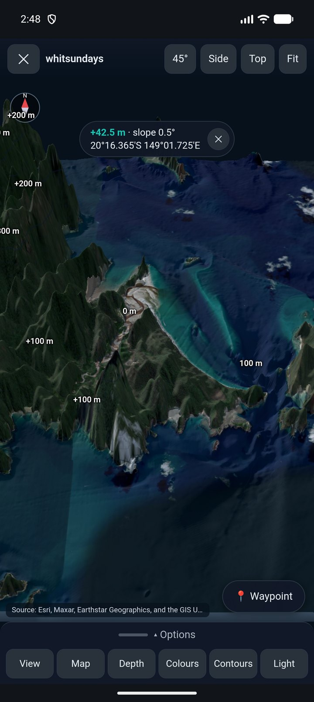
  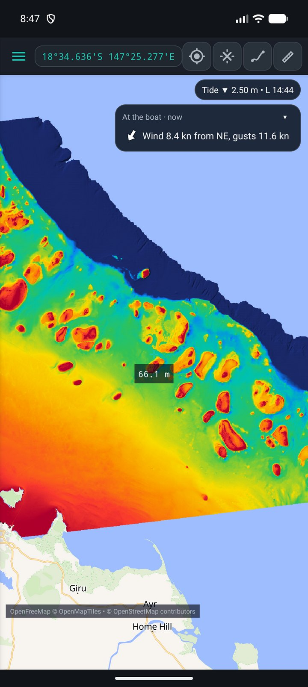
  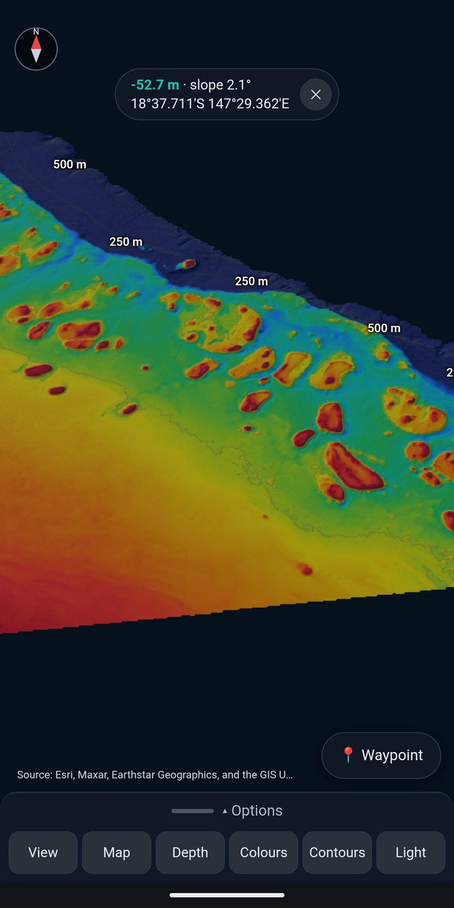

SeaBathy turns depth surveys into charts you can read on the water. Load your own
GeoTIFF surveys and MBTiles charts, or download free seabed depths for anywhere in the
world, then see them coloured by depth, fly over them in 3D, plan routes against your
draft and check tides, currents, wind and sea temperature. Everything works offline
once it's on the phone. Free and open source, with no account, ads or tracking.

> **Not for navigation.** SeaBathy does not include official nautical charts. Use it
> alongside proper charts and navigation equipment, never instead of them.

## Contents

- [Highlights](#highlights)
- [Screenshots](#screenshots)
- [Install](#install)
- [How to](#how-to)
- [All features](#all-features)
- [Also available](#also-available)
- [Privacy](#privacy)
- [Credits and licence](#credits-and-licence)

## Highlights

| | |
|---|---|
| 🗺️ **Your surveys, sharp** | GeoTIFF depth surveys, even multi-gigabyte BigTIFFs, coloured by depth with relief shading. The depth under the crosshair as you pan. |
| 🌊 **Free depths anywhere** | Download seabed depths for the area on screen, anywhere in the world (GMRT). |
| 🏝️ **3D seabed** | Rotate and fly over any depth layer. Exaggerate the height up to 100× so every reef wall stands out, drape satellite or offline maps over it, tap for depth and slope. |
| 📶 **Works offline** | Save satellite maps, tides and sea conditions for the area you fish, then use them with no signal. |
| 🌡️ **Tides and sea conditions** | Tide charts, wind, waves, swell, currents with moving flow lines, sea temperature and its breaks, chlorophyll, sea level and salinity. |
| 🧭 **Plan the trip** | Waypoints, routes with the least depth on every leg against your draft, tracks, anchor and depth alarms, GPX in and out. |

## Screenshots

| | | |
|:---:|:---:|:---:|
|  **Satellite on the 3D seabed** Whitehaven Beach and Hill Inlet |  **The seabed in 3D** Tap anywhere for depth and slope |  **Every reef in detail** A 10 m survey, coloured by depth |
| 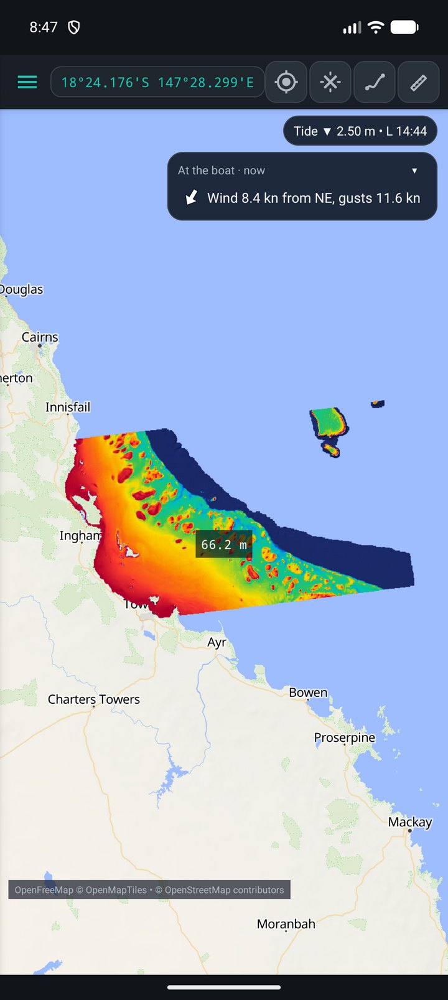 **Your survey on the chart** Over the basemap, with the depth at the crosshair | 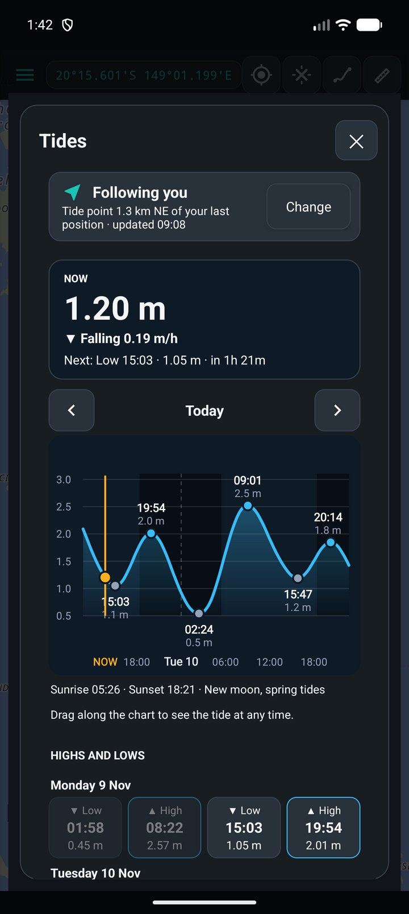 **Tides** Highs, lows, sun and moon, offline | 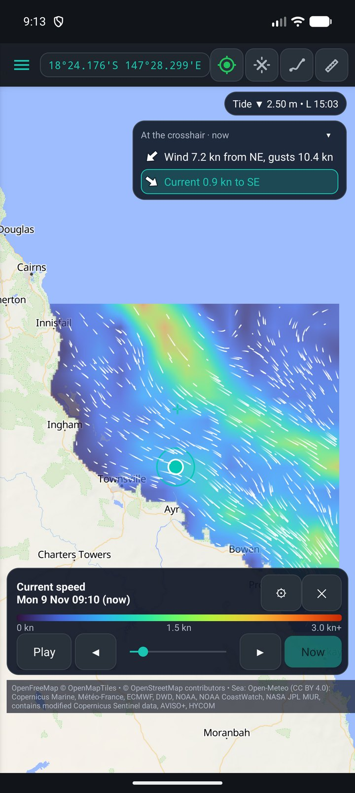 **Sea conditions** Currents with flow lines, wind and waves |

### Vertical exaggeration

Hardy Reef and Heart Reef on the Great Barrier Reef, a 10 m survey made with
[BathyPicker](https://github.com/SeaBathy/BathyPicker). Exaggerate the height to make every
reef wall, channel and bommie stand out, with depth colours or satellite on top.

| 10× | 100× | |
|:---:|:---:|:---:|
| 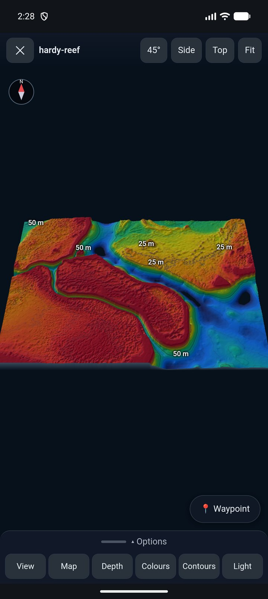 Depth colours at 10× | 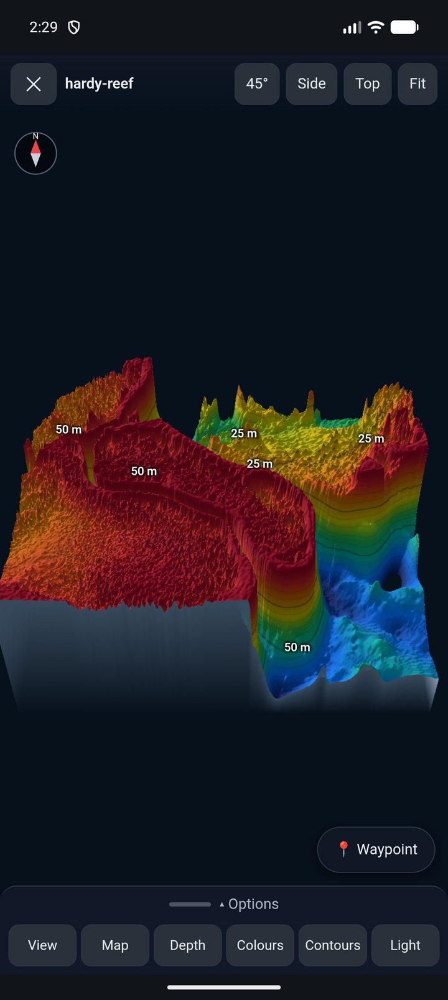 Depth colours at 100× | 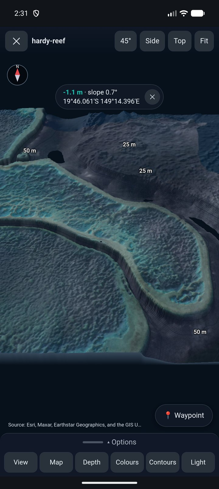 **Zoomed into the reef** with satellite, tapped for depth |
| 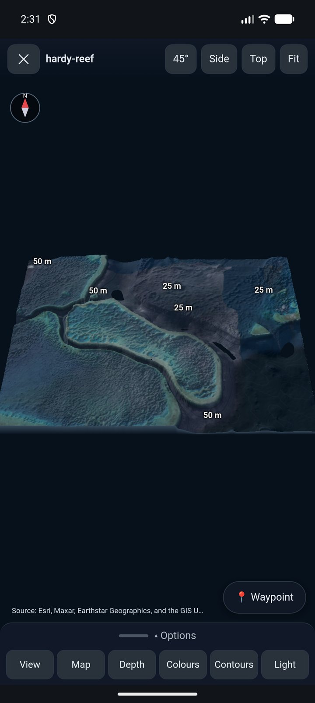 Satellite at 10× | 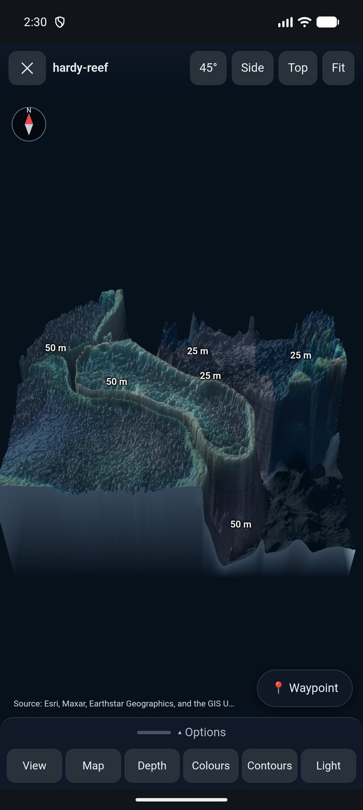 Satellite at 100× | |

## Install

1. Download **[`SeaBathy-1.0.1.apk`](download/SeaBathy-1.0.1.apk)** onto your phone (or
   from the Releases page).
2. Open it. If Android asks, allow your browser or file manager to *install unknown apps*.
3. Open SeaBathy. The first start shows the whole world; zoom in to where you go.

Needs Android 8.0 or newer. Large GeoTIFFs (over about 1 GB) use the app's built-in GDAL,
which runs on 64-bit phones (almost every phone from the last several years).

## How to

<b>Load your own depth survey or chart</b>

1. Copy the file to the phone (a GeoTIFF `.tif` survey, or an `.mbtiles` chart pack).
2. Open the menu (☰) → **Settings** → **Load GeoTIFF** or **Load MBTiles file**.
3. Pick the file. A GeoTIFF is checked, then appears as a depth layer and the map flies to it.
4. In the **Layers** drawer, tap **Colours** to choose a palette and depth range. The presets
   (reef and shallows, inshore, coastal, offshore) are a quick start.

Tip: for Australian waters, [BathyPicker](https://github.com/SeaBathy/BathyPicker) makes a GeoTIFF of any
area, up to 10 m detail.

<b>Get free seabed depths for anywhere</b>

Move the map to the area, then **Settings** → **Get seabed depths for this area**. The depths
come from GMRT, a free worldwide model built from ship surveys. They're sharpest where ships
have surveyed and coarser elsewhere, and they're saved on the phone for offline use.

<b>See the seabed in 3D</b>

1. In the **Layers** drawer, tap **3D view** on a depth layer.
2. One finger rotates, two fingers pan and zoom, double-tap flies in. Tap anywhere for the
   depth and slope there.
3. **View**: height (1:1 to 100×), camera presets, detail. **Map**: depth colours, satellite,
   your offline packs or your own map link, with a blend slider. **Depth**: show just one
   depth band at full detail. **Contours** and **Light** do what they say.

<b>Save maps for use with no signal</b>

Move the map to the area, then **Settings** → **Offline maps** → **Download the area on
screen**. You see the size first. The download runs in the background, survives patchy
signal, and the finished pack appears under your layers. The built-in source is
Sentinel-2 cloudless satellite imagery.

<b>Tides</b>

Tap the **Tide** chip at the top right. Choose a place, or let it follow the GPS. You get the
height now, the curve for the next day and a half, highs and lows, sunrise, sunset and the
moon. Save weeks or months ahead for offline use.

<b>Sea conditions</b>

**Settings** → **Sea conditions**. Pick what to show on the map (wind, current, waves, swell,
sea temperature, temperature breaks, chlorophyll, sea level, salinity). Data for 200 km round
your spot is downloaded and kept up to date, with a time slider, Play, and a values box at
the boat or the crosshair.

<b>Plan a route</b>

Tap the route button, then tap the chart to add points (or tap waypoints). **Legs** lists
each leg's bearing, distance, time, fuel and the least survey depth against your draft plus
safety margin. Save, reverse, export as GPX, or start navigating it.

<b>Units</b>

**Settings** → **Boat & navigation**: distance, speed, depth and fuel, and separately tide
height, wind (including Beaufort), waves and swell, current and sea temperature.

## All features

<b>Map layers</b>

- Offline MBTiles, raster and vector, and GeoTIFF depth rasters and imagery
- Public online map layers to add in a tap, plus your own XYZ tile link
- Satellite imagery, blendable over the depths to show reef, rock and coral
- One layer stack with visibility, opacity, order and delete; tap a layer to go to it
- Basemaps: dark, street map, your own, or none

<b>Depth</b>

- Seven palettes, your own depth range, reverse direction and relief-shading strength, all live
- Depth under the crosshair, exact from a GeoTIFF or bounded from contour charts
- A quality setting (battery saver to maximum) so 1 GB+ surveys stay sharp on capable phones and light on older ones

<b>3D</b>

- Rotate, pan, zoom, double-tap to fly in, 45° / Low / Top / Fit and a compass
- Height from true scale (1:1) to 100×; show one depth band at the survey's full detail
- Depth or slope colours, contours with depth labels, sun, shadows, sea surface, depth profiles
- Satellite, offline packs or your own map on the terrain, sharper as you zoom in
- Waypoints in 3D and a live boat marker with follow mode
- Detail adapts to the phone's memory, and steps down by itself if a phone struggles

<b>Routes, navigation and safety</b>

- Saved routes with bearing, distance, time, arrival, fuel and least depth per leg; GPX in and out
- Live navigation: DTW, BTW, XTE, SOG, COG, VMG, TTG and ETA, with arrival, off-course and shallow-water alarms (draft plus margin, tide included)
- Boat profile: cruise speed, fuel burn, tank and reserve, draft and safety margin; true or magnetic bearings; course-up; night red filter
- Anchor alarm with a swing circle, working with the screen off
- Track recording with the screen off; tracks shown on the chart or shared as GPX

<b>Tides and sea conditions</b>

- Tide curves, highs and lows, heights above the lowest tide, tide-corrected depths; saved offline for up to two years
- Currents (with the tide's flow), waves, swell and wind, hourly for up to 8 days
- Satellite sea temperature, temperature breaks, chlorophyll, sea level and salinity; temperature below the surface at a depth you choose
- Colour layers with moving flow lines, a time slider and values at the crosshair

<b>Also</b>

- Free seabed depths anywhere (GMRT); NASA's daily true colour picture; a latitude and longitude grid
- Offline map downloads with a size estimate, background progress and retries
- Waypoints with icons, colours, notes and search; measurement tool; DD, DDM and DMS coordinates
- Licences and credits screen in Settings

## Also available

- **[SeaBathy Desktop](https://github.com/SeaBathy/seabathy-desktop)**: the same app for Windows, for planning on the big screen.
- **[BathyPicker](https://github.com/SeaBathy/BathyPicker)**: draw a box anywhere in Australian waters and get a high-detail depth GeoTIFF for SeaBathy.
- **[AT5 Chart Maker](https://github.com/SeaBathy/AT5-Chart-Maker)**: turn depth contours or satellite pictures into charts for Simrad, Lowrance and B&G plotters.

## Privacy

SeaBathy has no accounts, ads or analytics, and sends nothing to this project. When you use
an online map or data service, your phone asks that service directly, so it sees your IP
address and the area you asked for. Surveys, waypoints and tracks stay on your phone. The
debug log is only shared if you share it.

**Offline downloads:** the built-in offline source is Sentinel-2 cloudless, whose licence
allows it. You can also download from any other map or link; that's your choice and your
responsibility under that provider's terms. Nothing is hosted or redistributed by this
project.

## Credits and licence

- **Code:** MIT licence, see [LICENSE](LICENSE).
- **Libraries:** [THIRD_PARTY_NOTICES.md](THIRD_PARTY_NOTICES.md). Full licence texts are in the app under Settings → Licences and credits.
- **Maps and data:** each map's credit is shown on screen while it's shown. Every source, its credit and its terms: [DATA_ATTRIBUTION.md](DATA_ATTRIBUTION.md).
- **Building from source, architecture and tests:** [DEVELOPMENT.md](DEVELOPMENT.md) and [BUILD_AND_TEST.md](BUILD_AND_TEST.md).
- **Changes:** [CHANGELOG.md](CHANGELOG.md). Contributions welcome: [CONTRIBUTING.md](CONTRIBUTING.md).

Screenshots use a 10 m survey of reefs off Townsville, and IMAS bathymetry (CC BY 4.0) of the
Whitsundays and of Hardy and Heart Reefs made with BathyPicker. IMAS covers the seafloor only,
so in the Whitsundays shots the island heights come from GMRT (CC BY 4.0).
