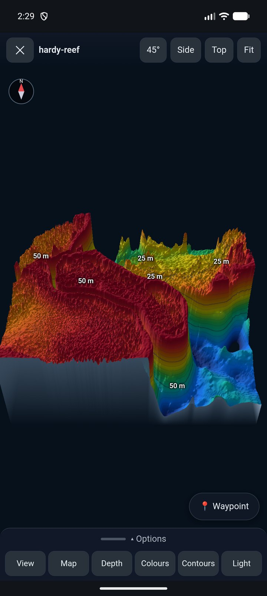
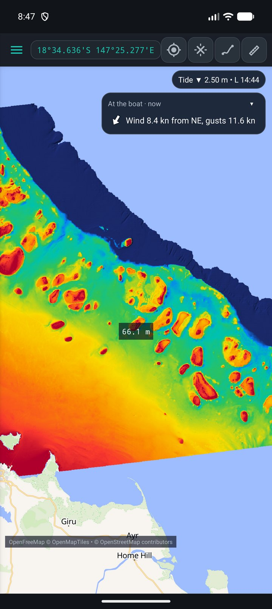
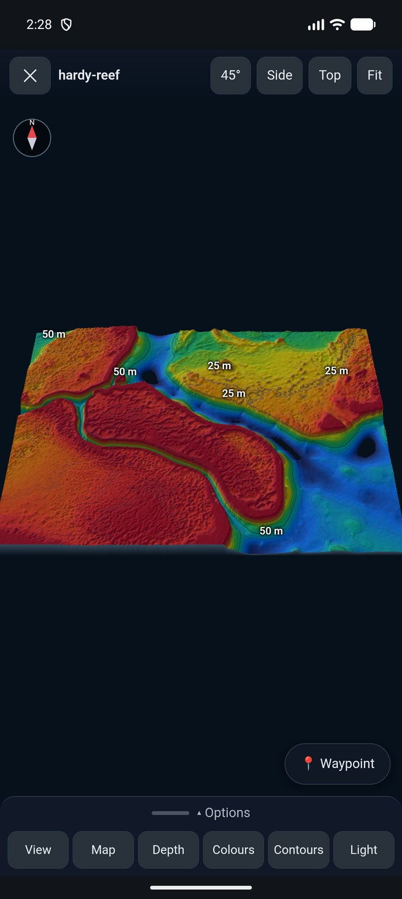
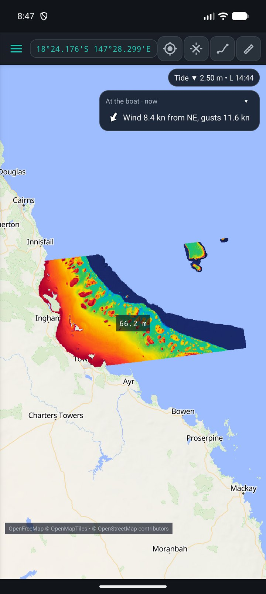
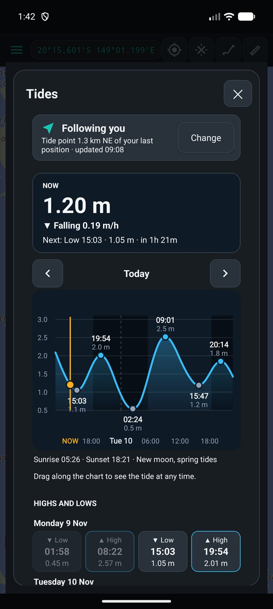
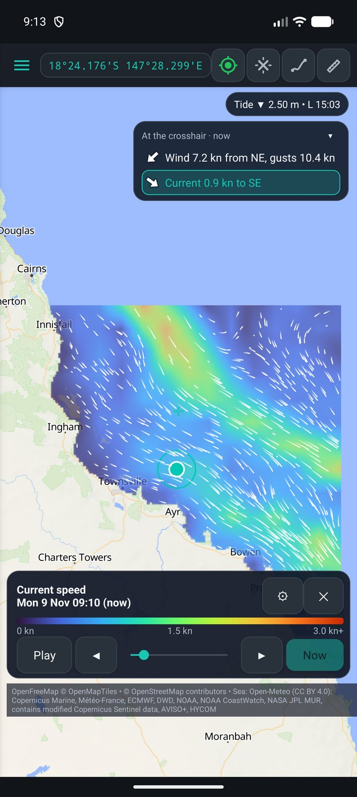

<h1 align="center">SeaBathy</h1>

<b>See what's under the boat.</b> 
Your depth maps in 3D, offline charts, tides and sea conditions. Works anywhere in the world.

  
  
  
  
  

  
  
  

SeaBathy turns depth surveys into charts you can read on the water. Load your own
GeoTIFF surveys and MBTiles charts, or download free seabed depths for anywhere in the
world, then see them coloured by depth, fly over them in 3D, plan routes against your
draft and check tides, currents, wind and sea temperature. Everything works offline
once it's on the phone. Free and open source, with no account, ads or tracking.

> **Not for navigation.** SeaBathy is not a nautical chart and must not be used for navigation.
> Its data comes from public sources and can be wrong or out of date. Use official charts and
> proper navigation equipment. See the [terms of use](https://seabathy.com/terms).

**New here?** The [how-to guide](https://seabathy.com/guide) shows the whole path in a few minutes: get free depths (right in the app, or with BathyPicker on a PC), open them on your phone or PC, and put it on your chartplotter with AT5 Chart Maker.

## Contents

- [Highlights](#highlights)
- [Screenshots](#screenshots)
- [Install](#install)
- [How to](#how-to)
- [All features](#all-features)
- [Also available](#also-available)
- [Privacy](#privacy)
- [Credits and licence](#credits-and-licence)

## Highlights

| | |
|---|---|
| 🗺️ **Your surveys, sharp** | GeoTIFF depth surveys, even multi-gigabyte BigTIFFs, coloured by depth or slope with relief shading and contour lines, shallow water in red. The depth under the crosshair as you pan. |
| 🌊 **Free depths anywhere** | Download seabed depths for an area you draw on the chart, anywhere in the world (GMRT), or in high detail, built on the phone: Australian waters (IMAS composite with AusSeabed and state multibeam surveys), US coasts (NOAA), surveyed Canadian coasts (CHS), European seas (EMODnet), New Zealand coasts surveyed by lidar (LINZ) and Pacific island reef shallows (Digital Earth Pacific). |
| 🏝️ **3D seabed** | Rotate and fly over any depth layer. Exaggerate the height up to 100× so every reef wall stands out, drape satellite or offline maps over it, tap for depth and slope. |
| 📶 **Works offline** | Save satellite maps, tides and sea conditions for the area you fish, then use them with no signal. |
| 🌡️ **Tides and sea conditions** | Tide charts, wind, waves, swell, currents with moving flow lines, sea temperature and its breaks, chlorophyll, sea level and salinity. |
| 🧭 **Plan the trip** | Waypoints, routes with the least depth on every leg against your draft, tracks, anchor and depth alarms, GPX in and out. |

## Screenshots

| | | |
|:---:|:---:|:---:|
|  **The seabed in 3D** Exaggerate the relief up to 100× |  **Contours and depths** Tap anywhere for depth and slope |  **Every reef in detail** A 10 m survey, coloured by depth |
|  **Your survey on the chart** Over the basemap, with the depth at the crosshair |  **Tides** Highs, lows, sun and moon, offline |  **Sea conditions** Currents with flow lines, wind and waves |

### Vertical exaggeration

Hardy Reef and Heart Reef on the Great Barrier Reef, a 10 m survey made with
[BathyPicker](https://github.com/SeaBathy/BathyPicker). Exaggerate the height to make every
reef wall, channel and bommie stand out, with depth colours or satellite on top.

| 10× | 100× |
|:---:|:---:|
|  Depth colours at 10× |  Depth colours at 100× |

## Install

1. Download **[`SeaBathy-1.4.4.apk`](download/SeaBathy-1.4.4.apk)** onto your phone (or
   from the Releases page).
2. Open it. If Android asks, allow your browser or file manager to *install unknown apps*.
3. Open SeaBathy. The first start shows the whole world; zoom in to where you go.

Needs Android 8.0 or newer on an ARM phone or tablet (almost all are). Big GeoTIFFs (over about 300 MB) and BigTIFFs use the app's built-in GDAL,
which runs on 64-bit phones (almost every phone from the last several years).

## How to

<b>Load your own depth survey or chart</b>

1. Copy the file to the phone (a GeoTIFF `.tif` survey, or an `.mbtiles` chart pack).
2. Open the menu (☰) → **Settings** → **Load GeoTIFF** or **Load MBTiles file**.
3. Pick the file. Files from the BathyPicker app are under **This device → Download → BathyPicker**.
   A GeoTIFF is checked, then appears as a depth layer and the map flies to it.
4. In the **Layers** drawer, tap **Colours** to choose a palette and depth range. The presets
   (reef and shallows, inshore, coastal, offshore) are a quick start.

Tip: for Australian waters, [BathyPicker](https://github.com/SeaBathy/BathyPicker) makes a GeoTIFF of any
area, up to 10 m detail.

<b>Get free seabed depths for anywhere</b>

**Settings** → **Depths** → **Get seabed depths**, then drag a finger across the chart to draw
the area (drag the box to move it, or a corner to resize it). The depths
come from GMRT, a free worldwide model built from ship surveys. They're sharpest where ships
have surveyed and coarser elsewhere, and they're saved on the phone for offline use.

**High detail** is offered in Australian waters (IMAS and multibeam surveys), on US coasts
(NOAA, about 3 m), on surveyed Canadian coasts and harbours (CHS), in European seas (EMODnet,
about 115 m), on New Zealand coasts surveyed by lidar since 2024 (LINZ, to about 25 m deep) and
on Pacific island reef shallows (Digital Earth Pacific, a satellite estimate to about 10 m).
The line under the box names the country and region and what it will get; GMRT fills any gaps.

<b>See the seabed in 3D</b>

1. In the **Layers** drawer, tap **3D view** on a depth layer.
2. One finger rotates, two fingers pan and zoom, double-tap flies in. Tap anywhere for the
   depth and slope there; a small ball marks the spot until you tap **Clear**.
3. **View**: height (1:1 to 100×), camera presets, detail. **Map**: depth colours, satellite,
   your offline packs or your own map link, with a blend slider. **Depth**: show just one
   depth band at full detail. **Contours** and **Light** do what they say.

<b>Save maps for use with no signal</b>

**Settings** → **Online and offline maps** → **Offline maps** → **Download** on a map, then
draw the area on the chart and set the detail with − and +. It says how many tiles that is,
and you see the size before anything is downloaded. The download runs in the background, survives patchy
signal, and the finished pack appears under your layers. The built-in source is
Sentinel-2 cloudless satellite imagery.

<b>Sharper satellite pictures</b>

The built-in satellite map is free Sentinel-2 imagery, about 10 m per pixel: good for reefs,
sand and channels, but soft up close. For more detail you can add any online satellite map
that gives an XYZ tile link (a web address with `{z}`, `{x}` and `{y}` in it) under
**Settings → Online and offline maps → Online map layers → Your own tile link**. Some providers have sub-metre imagery of most
coastlines. Those services are run by their owners under their own terms, which usually limit
how they may be used and whether they may be saved offline, so check before you save one. SeaBathy shows the credit you type with any map you add and can save any
of them offline: what you add and download, and keeping to each provider's terms, is up to you.
If a server refuses downloads, SeaBathy stops rather than keep asking, and suggests a service
that gives you your own key.

<b>Tides</b>

Tap the **Tide** chip at the top right. Choose a place, or let it follow the GPS. You get the
height now, the curve for the next day and a half, highs and lows, sunrise, sunset and the
moon. Save weeks or months ahead for offline use.

<b>Sea conditions</b>

**Settings** → **Sea conditions**. Pick what to show on the map (wind, current, waves, swell,
sea temperature, temperature breaks, chlorophyll, sea level, salinity, or the temperature at a
depth you choose). Data for 200 km round your spot is downloaded and kept up to date, with a
time slider and Play. Inland, the area goes over the nearest sea instead, and the box shows the
conditions there. The forecast comes first and shows within seconds (2 days unless you choose up
to 8); the satellite pictures follow, once a day. The colours stop at the shore, cut along
OpenStreetMap's coastline, which is saved with the weather. The dot on the box is green when it's the
latest forecast, amber while it updates, and red when it's out of date: tap it to update.

The values box shows the readings at the boat, or at the crosshair while a layer is on: surface
temperature and chlorophyll, then the temperature at your chosen depth, then salinity and sea
level. Tap a line to show that layer on the map. **Save the area on screen** keeps another fishing
ground, up to about 500 km across. Temperature breaks are where warm and cold water meet, often
where fish gather.

<b>Plan a route</b>

Tap the route button, then move the map so the crosshair is on each point and tap to add it
(or tap waypoints). **Legs** lists each leg's bearing, distance, time, fuel and the least survey
depth against your draft plus safety margin.

**Settings** → **Saved routes**: load, reverse, rename, export as GPX, or **Go** to navigate it.
While navigating you get distance and bearing to the next point, cross-track error and ETA, with
arrival, off-course and shallow-water alarms. Set your draft and margin in **Boat & navigation**.

<b>Waypoints</b>

Tap the waypoint button, move the map so the crosshair is on the spot, and tap the map. Give it a
name, icon, colour and notes, and change any of them later. Tap a waypoint on the chart to see or edit it, and search them all
from the Layers drawer.

**Photos:** open a waypoint and tap **Take a photo**: it's saved with the time, tide, wind, waves,
swell, current, sea temperature, sun and moon there. Forgot to drop a mark? **Waypoint from a
photo** (Layers drawer or Settings) makes one where a gallery photo was taken, from its GPS tags (or where you are, or at
the crosshair, if it has none), with the tide, sun and moon then, and the wind and sea that hour from Open-Meteo's archive.

<b>Man overboard</b>

Tap the red **MOB** button at the top. It marks the boat's position (or the first GPS fix, if the
GPS was off) as a waypoint, buzzes, and starts steering back to it.

<b>Marine park zones, reef names and boat ramps</b>

Turn them on in **Settings → Australia** (they cover Australian waters only). Zones cover every Australian marine park, from each authority's official zoning:
no-take in green, limited fishing in yellow, general use in blue; show all or only the no-take ones,
and tap a zone for its official name and what's allowed.
With the GPS on, the phone buzzes and warns you when the boat goes into a no-take zone. A guide
only: the official zoning map is the law.

<b>Good-weather alerts</b>

**Sea conditions** → **Good-weather alert**: add up to three places on the map, each with how far
round it to check (2 to 50 km), and set the most wind, gusts and waves you'll go out in, how many
hours in a row, between which hours, how far ahead and on which days. Every 4 hours Android runs a
small check for a few seconds (the app itself doesn't run, so it costs next to no battery) and
tells you when a day starts or stops looking good, with a line for each day: times, wind and
direction, gusts and waves, the worst anywhere in the circle. Nothing is sent between 9 pm and 7 am.
When a day looks good it also saves that place's forecast (on any connection, Wi-Fi only, or not
at all), so tapping the alert shows it straight away, even offline. Saved forecasts are removed by
themselves 2 days after they run out.

<b>Backup and restore</b>

**Settings** → **Backup and restore** saves your waypoints and their photos, routes, tracks and
settings in one file. Turn on the daily backup and pick a folder (Google Drive, OneDrive, an SD
card…) to keep the newest five there. A SeaBathy Desktop backup adds its waypoints and routes.

<b>Anchor alarm</b>

**Settings** → **Anchor alarm** → **Drop anchor at the boat**. Set the alarm circle to your anchor
line plus a boat length. It keeps watching with the screen off, and sounds if the boat drags out
of the circle or the GPS goes quiet for a minute. **Stop anchor alarm** ends it.

<b>Record a track</b>

**Settings** → **Tracks** → **Start recording**. It records with the screen off, shown by a
notification. **Stop and save** when you're done, then show it on the chart or **Share GPX**.

<b>Swap marks with a plotter or PC (GPX)</b>

**Settings** → **Import GPX, KML or KMZ** reads waypoints and routes from a chartplotter, Google
Earth, SeaBathy Desktop or another app. **Export waypoints and route** shares yours as a GPX file.

<b>Units</b>

**Settings** → **Boat & navigation**: distance, speed, depth and fuel, and separately tide
height, wind (including Beaufort), waves and swell, current and sea temperature.

## All features

<b>Map layers</b>

- Offline MBTiles, raster and vector, and GeoTIFF depth rasters and imagery
- Public online map layers to add in a tap, plus your own XYZ tile link
- Satellite imagery, blendable over the depths to show reef, rock and coral
- One layer stack with visibility, opacity, order and delete; tap a layer to go to it; a hidden layer gives its memory back
- Basemaps: dark, street map, your own, or none

<b>Depth</b>

- Seven palettes, your own depth range, reverse direction and relief-shading strength, all live
- Colour by slope instead of depth, so ledges and drop-offs stand out
- Contour lines with depth labels, spaced to suit the depths on screen or as you choose
- Shallow water striped red below a depth you pick, on every depth layer and in 3D
- Depth under the crosshair, exact from a GeoTIFF or bounded from contour charts
- A quality setting (battery saver to maximum) so 1 GB+ surveys stay sharp on capable phones and light on older ones

<b>3D</b>

- Rotate, pan, zoom, double-tap to fly in, 45° / Low / Top / Fit and a compass
- Height from true scale (1:1) to 100×; show one depth band at the survey's full detail
- Depth or slope colours, contours with depth labels, sun, shadows, sea surface, depth profiles
- Satellite, offline packs or your own map on the terrain, sharper as you zoom in
- Waypoints in 3D, a marker where you tap, and a live boat marker with a line to the seabed and follow mode
- Detail adapts to the phone's memory, and steps down by itself if a phone struggles

<b>Routes, navigation and safety</b>

- Saved routes with bearing, distance, time, arrival, fuel and least depth per leg; GPX in and out
- Live navigation: DTW, BTW, XTE, SOG, COG, VMG, TTG and ETA, with arrival, off-course and shallow-water alarms (draft plus margin, tide included)
- Boat profile: cruise speed, fuel burn, tank and reserve, draft and safety margin; true or magnetic bearings; course-up; night red filter
- Anchor alarm with a swing circle, working with the screen off
- Track recording with the screen off; tracks shown on the chart or shared as GPX

<b>Tides and sea conditions</b>

- Tide curves, highs and lows, heights above the lowest tide, tide-corrected depths; saved offline for up to two years
- Currents (with the tide's flow), waves, swell and wind, hourly for up to 8 days
- Satellite sea temperature, temperature breaks, chlorophyll, sea level and salinity; temperature at a depth you choose (10 to 300 m)
- Colour layers with moving flow lines, a time slider and values at the crosshair
- Labelled temperature lines, a target temperature band, eddy outlines, and sun, moon and solunar times
- Good-weather alerts for up to three places, with wind, gust and wave limits, hours and days

<b>Also</b>

- Free seabed depths anywhere (GMRT), and high-detail depths built on the phone for Australia (IMAS, AusSeabed), the USA (NOAA), Canada (CHS), Europe (EMODnet), New Zealand (LINZ) and the Pacific islands (Digital Earth Pacific); NASA's daily true colour picture; a latitude and longitude grid
- Offline map downloads of an area you draw, with a tile count, a size estimate, background progress and retries
- Waypoints with icons, colours, notes and search; measurement tool; positions written as DDM, DMS or DD, your choice
- A scale bar, a course arrow on the boat, and a storage screen showing what the app keeps
- Licences and credits screen in Settings

## Also available

- **[SeaBathy Desktop](https://github.com/SeaBathy/seabathy-desktop)**: the same app for Windows, for planning on the big screen.
- **[BathyPicker](https://github.com/SeaBathy/BathyPicker)**: draw a box anywhere in Australian waters and get a high-detail depth GeoTIFF for SeaBathy.
- **[AT5 Chart Maker](https://github.com/SeaBathy/AT5-Chart-Maker)**: turn depth contours or satellite pictures into charts for Simrad, Lowrance and B&G plotters.

## Privacy

SeaBathy has no accounts, ads or analytics, and sends nothing to this project. When you use
an online map or data service, your phone asks that service directly, so it sees your IP
address and the area you asked for. Surveys, waypoints and tracks stay on your phone. The
debug log is only shared if you share it.

**Offline downloads:** the built-in offline source is Sentinel-2 cloudless, whose licence
allows it. You can also download from any other map or link; that's your choice and your
responsibility under that provider's terms. Nothing is hosted or redistributed by this
project.

## Credits and licence

- **Code:** GNU GPL-3.0, see [LICENSE](LICENSE): free to use, change and share; anyone who shares a copy or a changed version must keep it free and open source under the same licence.
- **Libraries:** [THIRD_PARTY_NOTICES.md](THIRD_PARTY_NOTICES.md). Full licence texts are in the app under Settings → About → Licences and credits.
- **Maps and data:** each map's credit is shown on screen while it's shown. Every source, its credit and its terms: [DATA_ATTRIBUTION.md](DATA_ATTRIBUTION.md).
- **Building from source, architecture and tests:** [DEVELOPMENT.md](DEVELOPMENT.md) and [BUILD_AND_TEST.md](BUILD_AND_TEST.md).
- **Changes:** [CHANGELOG.md](CHANGELOG.md). Contributions welcome: [CONTRIBUTING.md](CONTRIBUTING.md).

Screenshots use a 10 m survey of reefs off Townsville, and IMAS bathymetry (CC BY 4.0) of the
Whitsundays and of Hardy and Heart Reefs made with BathyPicker. IMAS covers the seafloor only,
so in the Whitsundays shots the island heights come from GMRT (CC BY 4.0).
